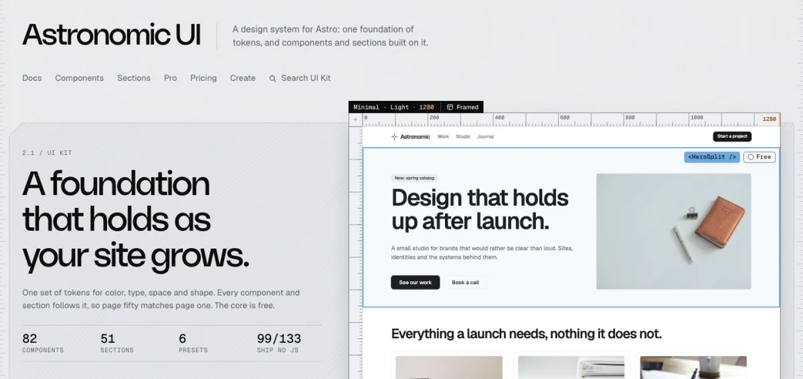

# Astronomic UI

[](https://astronomic.dev/ui)

Free, restylable Astro components driven by semantic `--ui-*` tokens: navbars, heroes, cards, forms, footers, features, listings, search and more, in one consistent look. Swap a preset or a few token values and every component follows, dark mode included.

- Works in any plain Astro site. Components take plain props and slots, never CMS objects.
- No React needed: the interactive parts (the menu, the mode switch, the forms) are native HTML with small scripts.
- Tailwind CSS v4 utilities on the kit's tokens.

Docs and live examples: [astronomic.dev/ui](https://astronomic.dev/ui). Package: [npm](https://www.npmjs.com/package/@astronomic-dev/ui). Source and issues: [GitHub](https://github.com/astronomic-dev/astronomic-ui).

## Install

Astronomic UI needs Astro 7 and Tailwind CSS v4. Install it with its peers:

```sh
pnpm add @astronomic-dev/ui astro tailwindcss @tailwindcss/vite
```

Add Tailwind's Vite plugin in `astro.config.mjs`:

```js
import tailwindcss from "@tailwindcss/vite";
import { defineConfig } from "astro/config";

export default defineConfig({
	vite: { plugins: [tailwindcss()] },
});
```

## Set up the CSS

In the site's main CSS file:

```css
@import "tailwindcss";
@import "@astronomic-dev/ui/tokens.css";
@import "@astronomic-dev/ui/theme.css";
@import "@astronomic-dev/ui/presets/soft.css"; /* optional: a preset, after tokens.css */

/* Tailwind skips node_modules, so point it at the component source.
   The path is relative to this CSS file (here: src/styles/global.css). */
@source "../../node_modules/@astronomic-dev/ui/src";
```

Without the `@source` line the components render unstyled.

Without a preset you get the default look, Minimal. The presets in `@astronomic-dev/ui/presets/`:

| Preset | File | Fonts | Fontsource packages |
| --- | --- | --- | --- |
| Minimal (default) | none, `tokens.css` alone | Geist | `@fontsource-variable/geist` |
| Clean | `clean.css` | Inter | `@fontsource-variable/inter` |
| Modern | `modern.css` | Plus Jakarta Sans | `@fontsource-variable/plus-jakarta-sans` |
| Playful | `playful.css` | Bricolage Grotesque and Nunito | `@fontsource-variable/bricolage-grotesque`, `@fontsource-variable/nunito` |
| Soft | `soft.css` | Figtree | `@fontsource-variable/figtree` |
| Ink | `ink.css` | Newsreader and Libre Franklin | `@fontsource-variable/newsreader`, `@fontsource-variable/libre-franklin` |

Load the fonts your preset uses, from Fontsource or Google Fonts. Every font stack names both family names (`"Geist", "Geist Variable", ...`), so either source works.

## Use a component

Import components by path:

```astro
---
import "../styles/global.css";
import Button from "@astronomic-dev/ui/components/Button.astro";
---

<Button href="/start">Get started</Button>
```

Use only the kit's token-based classes next to the components, and never the `dark:` variant: dark mode swaps the token values.

Many parts come in families (the navbar, hero, card, footer and so on). Each family has one shell and a few recipes, such as `FooterSimple` and `FooterColumns`. Use the recipes on a page, and a shell alone only to build a layout of your own.

Every component, its props and its slots: [astronomic.dev/ui](https://astronomic.dev/ui).

## Site search

The search components (`SearchClassic`, `SearchButton`, `SearchPage`) run on the free `@astronomic-dev/search` package, which the kit does not install. To use them, add it to your site:

```sh
pnpm add @astronomic-dev/search
```

The other components do not need it.

## License

MIT. See [LICENSE](LICENSE).

## More from Astronomic

- [Astronomic Search](https://astronomic.dev/plugins/search): free, typo-tolerant site search for Astro.
- [Vesper](https://astronomic.dev/themes/vesper): a free Astro theme for a personal blog and portfolio.
- [Astronomic Starter](https://astronomic.dev/themes/starter): a free Astro starter for a small product site, with a blog and guides.
- [wp-esc](https://astronomic.dev/learn/wordpress): plan a move from WordPress to Astro or EmDash.
- [All Astronomic themes](https://astronomic.dev/themes)
